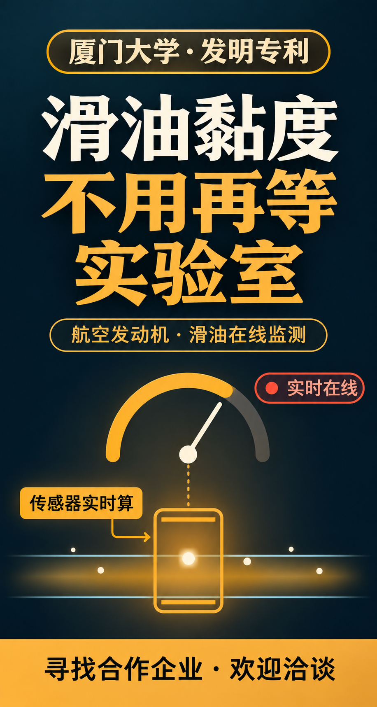
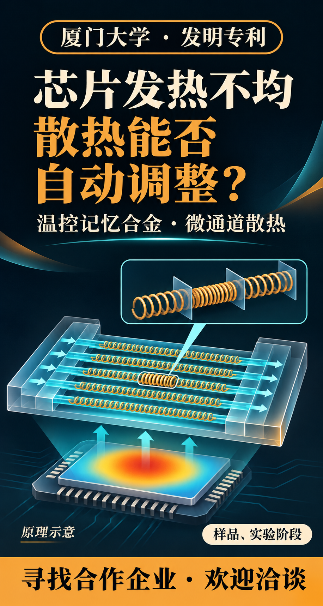

<div align="center">

# Patent Video Studio

**把专利资料讲成企业看得懂的竖版短视频。**

面向成果转化的中文 Agent Skill：读资料、核事实、写分镜，再用固定程序完成动画、配音、字幕、混音和导出。


[下载技能包](https://github.com/Haoea1024/patent-video-studio/releases/latest) · [快速开始](#快速开始) · [配置说明](references/CONFIG.md) · [验证记录](references/VERIFIED.md)

</div>

## 看看效果

**v0.2：必须把技术过程演出来。** 新增磁共振数据生成与重建动画、项目专用动画接口、主体连续帧检查。只有流程框、文字卡片或图片缩放的项目会被拦截。已安装用户请替换完整技能ZIP，并按[迁移说明](references/ANIMATION.md#从旧版升级)更新旧配置。

[磁共振机制动画的连续状态预览](examples/mri-motion-storyboard.jpg) · [可直接运行的MRI示例](examples/mri.json) · [动画制作与验收](references/ANIMATION.md)

设计风格来自三个专利样片：深蓝底、宋体标题、琥珀色重点、青色原理线条。机构标识从首帧出现，封面独立保存。

| 滑油在线检测 | 芯片自适应散热 | 铜网油水分离 |
| :---: | :---: | :---: |
|  |  |  |
| [示例配置](examples/oil.json) · [分镜](examples/oil-approved-storyboard.jpg) | [示例配置](examples/thermal.json) · [分镜](examples/thermal-approved-storyboard.jpg) | [示例配置](examples/mesh.json) · [分镜](examples/mesh-approved-storyboard.jpg) |

**[查看 / 下载通用程序生成的 54 秒验证样片](https://github.com/Haoea1024/patent-video-studio/blob/main/docs/media/mesh-demo.mp4)**

上方是样片的视觉参考，不是效果保证。封面由图像生成工具制作；没有绘图工具时，脚本也能生成排版封面，但质感不同。示例配置适配了通用引擎，并非逐像素复刻原样片。

## 它解决什么问题

让模型从零写动画代码，容易出现字幕不同步、结尾换样式、音乐盖过解说，或者新专利还残留上一个项目的信息。

这里把工作分成两部分：

| 模型负责 | 程序负责 |
| --- | --- |
| 理解资料、辨认受众、核对来源 | 固定尺寸、布局与动画组件 |
| 提炼痛点、机制、价值和成熟度 | 按真实语音确定时间轴与字幕 |
| 选择合适的镜头、填写 JSON | 音乐压低、封面嵌入、编码与检查 |

这样可以减少对模型临场写代码能力的依赖。适合用同一份技能和资料比较不同模型；专利理解与物理机制仍需核实。

## 主要能力

- **机制动画与辅助镜头**：传感信号、热响应、油水分离、材料加工，以及五种磁共振场景；流程、信息卡、图片用于辅助介绍。未覆盖的技术可通过项目专用Canvas接口扩展。
- **防止纯文字出片**：至少两镜机制演示，占非结尾正文≥35%；逐镜记录动作与因果，自动采样三时点检查主体状态变化。背景粒子、字幕和转场不会计入主体检查。
- **可追溯内容**：每段文案引用事实卡，事实卡记录文件页码或网页位置；标注实际成熟度。
- **真实时间戳字幕**：支持逐词高亮；只有句级时间戳时整句显示，不伪造逐词同步。
- **轻背景音乐**：内置配乐、均衡、淡入淡出和人声侧链压低；署名不占视频画面。
- **独立封面**：PNG 单独交付，同时写入 MP4 封面元数据，不插入播放内容。
- **输出检查**：字段、出处引用、禁读专利号、字幕行数、旧缓存、帧数、解码、响度和真峰值。
- **外部配音接口**：默认 Edge TTS；也可导入国产或本地服务生成的音频与时间戳。

## 快速开始

### 路径一：装进 WorkBuddy

1. 从 [Releases](https://github.com/Haoea1024/patent-video-studio/releases/latest) 下载 **`patent-video-studio.zip`**。
2. 在 WorkBuddy 选择 **技能 / Skills → 添加技能 → 上传技能**，上传完整 ZIP。不要只上传 `SKILL.md`。
3. 提供专利 PDF，并发送下面这段指令。

> 请使用 patent-video-studio，根据这份专利资料制作面向潜在合作企业的竖版视频。先读 ANIMATION.md，核对事实并为每个技术镜头写明对象、作用和状态变化。至少两镜真实机制演示，不要做成文字卡片或只有流程箭头。优先使用匹配的内置动画；没有匹配模板就在项目中通过custom接口制作专用动画，不重写公共导出程序。查看motion-storyboard.jpg确认初态/中间/结果变化，完成配音、同步字幕、轻配乐和独立封面，检查后交付MP4。资料里找不到的信息不要编。

安装入口依据 [WorkBuddy 官方文档](https://www.workbuddy.ai/docs/workbuddy/From-Beginner-to-Expert-Guide/Function-Description/Skills)。**目前尚未在 WorkBuddy 客户端实际导入验证**；客户端入口和权限以实际版本为准。首次运行仍需准备 Python、依赖和浏览器，具体步骤见 [环境说明](references/SETUP.md)。

### 路径二：本地运行示例

需要 Python 3.10+、Chromium / Edge / Chrome，以及中文字体。以下为 Windows PowerShell 命令；默认配音需要网络。

```powershell
git clone https://github.com/Haoea1024/patent-video-studio.git
cd patent-video-studio

python -m venv .venv
.\.venv\Scripts\python.exe -m pip install -r requirements.txt
.\.venv\Scripts\python.exe -m playwright install chromium
.\.venv\Scripts\python.exe scripts/pipeline.py doctor

# 使用已核对的铜网示例，输出到仓库外的新目录
.\.venv\Scripts\python.exe scripts/pipeline.py build examples/mesh.json --out ../patent-video-demo
```

完成后打开 `../patent-video-demo/video.mp4`、`cover.png` 和 `validation.json`。

<details>
<summary>macOS / Linux 命令与环境说明</summary>

```bash
python3 -m venv .venv
.venv/bin/python -m pip install -r requirements.txt
.venv/bin/python -m playwright install chromium
.venv/bin/python scripts/pipeline.py doctor
.venv/bin/python scripts/pipeline.py build examples/mesh.json --out ../patent-video-demo
```

这些平台尚未实测。需安装可用的中文字体和 Playwright 系统依赖；缺字要通过预览图确认。FFmpeg 由 `imageio-ffmpeg` 提供，不需要另行配置 PATH。已有浏览器可通过 `PATENT_VIDEO_CHROME` 指定；FFmpeg 可通过 `PATENT_VIDEO_FFMPEG` 指定。

</details>

## 用自己的专利

建议先按阶段执行，确认内容后再完整导出。下面的 `python` 指已经装好依赖的解释器。

```powershell
# 1. 提取文本，渲染需要查看的页；页码是 PDF 实际页序号
python scripts/pipeline.py extract "D:/materials/patent.pdf" --pages 1,2 --out "../my-patent/source"

# 2. 复制最接近的配置起点：oil / thermal / mesh / mri
python scripts/pipeline.py init --example mesh --out "../my-patent"

# 3. 编辑 project.json，替换全部项目事实与文案，再校验
python scripts/pipeline.py validate "../my-patent/project.json" --out "../my-patent/build"

# 4. 配音与预览
python scripts/pipeline.py audio "../my-patent/project.json" --out "../my-patent/build"
python scripts/pipeline.py preview "../my-patent/project.json" --out "../my-patent/build"

# 5. 查看分镜、motion-storyboard.jpg、motion-check.json和封面
# 核对事实与对象状态变化后将 review 两项设为 true
# 配置有变化，重新 audio；未变的语音会复用缓存
python scripts/pipeline.py audio "../my-patent/project.json" --out "../my-patent/build"
python scripts/pipeline.py render "../my-patent/project.json" --out "../my-patent/build"
```

**换专利时不能只换标题。** 权利人、专利类型、号码、来源、机制、受众、成熟度、联系方式和镜头都要重新核对。没有资料就不要沿用示例的“厦门大学”或联系信息。

默认叙事为：**问题 → 方案 → 原理 → 特点 → 企业价值与成熟度 → 合作邀请**。不同领域按实际机制选择镜头，通常 4–8 镜、45–70 秒。

完整字段与例子见 [配置指南](references/CONFIG.md) 和 [JSON Schema](references/project.schema.json)。

## 国产模型与国产工具链

两种测试方式可以分开进行：

| 目标 | 做法 |
| --- | --- |
| 测试国产模型能否理解专利并组织出片 | 使用同一技能、相同 PDF 与通用工具；默认配音走 Edge TTS |
| 模型、配音和绘图全部使用国产服务 | 使用当前已配置的国产服务，导入外部音频清单；绘图结果保存为本地图片 |

```powershell
python scripts/pipeline.py audio "../my-patent/project.json" --out "../my-patent/build" --external-audio "../my-patent/external-audio.json"
python scripts/pipeline.py preview "../my-patent/project.json" --out "../my-patent/build"
python scripts/pipeline.py render "../my-patent/project.json" --out "../my-patent/build"
```

清单支持每镜音频 + 词级或句级时间戳，格式见 [配音接口](references/AUDIO.md)。本项目没有内置未经验证的国产服务 API，也不替你开通付费账号。**已验证外部音频接口，尚未验证具体国产模型或国产 TTS 服务的端到端效果。**

## 交付文件

| 文件 | 用途 |
| --- | --- |
| `video.mp4` | 1080×1920、24fps，H.264 + AAC 的竖版视频 |
| `cover.png` | 独立封面；平台不读取 MP4 封面元数据时手动上传 |
| `storyboard.jpg` | 各镜头预览，用于检查布局与叙事 |
| `motion-storyboard.jpg` / `motion-check.json` | 技术主体三时点预览、变化检测与正文演示时长占比 |
| `captions.srt` / `narration.txt` | 可复用的字幕与配音文案 |
| `publish-notes.txt` | 发布时需保留的音乐署名 |
| `validation.json` | 自动检查结果，不替代事实审核和试听 |

## 验证与边界

已在 Windows / Python 3.14 环境完成真实出片、四类示例主体动画检查、中文路径迁移、外部音频和封面检查；现有18项自动测试，包括冻结主体的失败案例与custom接口。实际视频的音频与动画检查记录见 [验证记录](references/VERIFIED.md)。

当前边界：

- 尚未验证 WorkBuddy 实际导入、指定国产模型或 macOS / Linux 的完整流程。
- 自动检查不证明专利事实、专业术语发音或物理因果正确。
- 固定图解不能覆盖所有新原理；不匹配时需要通过custom接口制作专用动画，不能自动退回纯文字讲解。模型的专用动画代码能力仍会影响最终质感。
- 像素变化检测不等于科学有效性验证；需核查动作因果、模拟标注和视觉质量。磁共振测试图为合成演示，不是专利算法实测或临床性能证据。
- 排版封面可离线渲染；生成式封面需要实际可用的图像工具。
- PDF 提取和编码在本地进行；默认 Edge TTS 会发送配音文本。完全本地需求请用外部本地语音流程。

## 文档导航

| 你想做什么 | 文档 |
| --- | --- |
| 让 Agent 按完整流程执行 | [SKILL.md](SKILL.md) |
| 安装依赖、处理环境问题 | [SETUP](references/SETUP.md) |
| 选题、写文案、核实证据 | [CONTENT](references/CONTENT.md) |
| 选镜头、填写配置 | [CONFIG](references/CONFIG.md) |
| 让技术过程动起来、扩展未覆盖机制 | [ANIMATION](references/ANIMATION.md) |
| 接入其他语音服务 | [AUDIO](references/AUDIO.md) |
| 制作独立封面 | [COVER](references/COVER.md) |
| 检查效果与常见错误 | [QA](references/QA.md) |

## 开发与打包

```powershell
python -m unittest discover -s tests -v
python scripts/package_skill.py --out dist
```

打包脚本生成可导入的 `patent-video-studio.zip` 和 `SHA256SUMS.txt`，ZIP 根目录保留 `SKILL.md`。它仅收录明确列出的技能文件，不包含本地虚拟环境、缓存、生成工程或凭据。

报告问题时，请附操作系统、Python 版本、命令、错误信息和脱敏配置。不要上传私有专利材料、账号密钥或聊天记录。

## 素材与许可

背景音乐 **Inspired — Kevin MacLeod** 使用 CC BY 4.0，发布时保留署名。详情见 [第三方说明](THIRD_PARTY_NOTICES.md) 和 [音乐许可说明](assets/MUSIC-LICENSE.txt)。机构、专利与图片仅作为案例展示，不代表相关机构为此工具背书。

代码与文档目前尚未指定开源许可证；仓库公开不等同于授予任意使用或再分发许可。音乐的独立许可不适用于其他内容。

README 组织参考了 [Anthropic Skills](https://github.com/anthropics/skills)、[Remotion](https://github.com/remotion-dev/remotion) 和 [yt-dlp](https://github.com/yt-dlp/yt-dlp)：效果先行、给出最短使用路径、把深度文档与排错分层组织。
